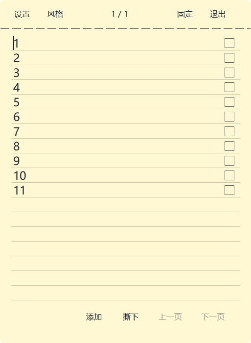

# 轻笺 · LightNotes

C++20 编写的 Windows 桌面便签与待办软件，使用原生 Win32、DirectX 11 / DXGI 和 GDI 绘制。启动后直接显示便签。

[下载 Windows 软件](https://github.com/wodengnisinian/LightNotes/releases/latest) · [验证说明](docs/verification.md) · [更新记录](CHANGELOG.md)



## 功能

- 每行一件待办：内容区带下划线，右侧勾选后移除事项并立即保存。
- 多页便签：添加、撕下、上一页、下一页；新增保留当前页，撕下有弯曲、掉落和淡出动画。
- 纸张、磨砂玻璃、平滑玻璃：可调整颜色、透明度、磨砂强度和字号。
- 自由拖动、调整宽高、定位到桌面四角；“固定”只锁定整本位置。
- 窗口置顶、登录 Windows 后自动启动、恢复未完成事件，均在设置中单独控制。
- 每页只读、定时提醒、最近撕下纸张恢复、托盘管理。

当前外观为平面圆角便签，不显示厚度边框或阴影。正文不滚动；超出可见范围的文字仍保留，可放大便签或缩小字号查看。玻璃采样只在内存处理，为避免采集自身，玻璃窗口会从部分截屏工具中排除。

## 运行

下载 Release 中的 `LightNotes-3.1.0-win-x64.zip`，解压后运行 `LightNotes.exe`。将 `LightNotes.manifest` 和 `LightNotes.ico` 与程序保留在同一目录。

建议 Windows 10 2004 及以上或 Windows 11，x64。验证环境为 Windows x64；旧版 Windows、不同显卡、远程桌面和多显示器的视觉表现尚未全面验证。

“设置”和“风格”内容独立，修改后点击“应用设置”或“应用风格”；直接关闭会放弃未应用的草稿。“窗口置顶”和“开机自动启动”默认关闭，开启后保存。“开机自动启动”在当前用户登录后启动；移动软件后需重新关闭/开启该选项更新路径。

数据保存在 `%LOCALAPPDATA%\LightNotes`。本地自动保存使用临时文件、原子替换和 `.bak` 备份。记忆设置默认开启，启动恢复未完成事件、页序和当前页。关闭记忆后打开空白页，原事项仍保留。关闭软件后提醒不运行。

## 快捷键

| 快捷键 | 操作 |
| --- | --- |
| Ctrl+N | 添加纸张 |
| Ctrl+S | 保存 |
| Ctrl+P | 固定 / 解锁整本位置 |
| Ctrl+L | 切换本页只读 |
| Ctrl+Tab / Ctrl+Shift+Tab | 下一页 / 上一页 |
| Esc | 隐藏便签 |
| Ctrl+Alt+N | 全局添加 |

## 编译

已验证 Zig 0.13.0 的 C++ 工具链。将 `zig.exe` 加入 PATH，或指定编译器完整路径：

```powershell
powershell -NoProfile -ExecutionPolicy Bypass -File .\build.ps1
powershell -NoProfile -ExecutionPolicy Bypass -File .\build.ps1 -Compiler C:\Tools\zig\zig.exe
```

脚本使用 C++20、`-Wall -Wextra -Werror`、`-O2 -g0`，生成目录内的 `LightNotes.exe`。

也提供 CMake 配置与 Windows GitHub Actions 构建：

```powershell
cmake -S . -B build
cmake --build build --config Release
```

## 源码

| 文件 | 职责 |
| --- | --- |
| `main.cpp` | 应用入口、窗口消息、便签模型、保存与提醒 |
| `storage.h` / `session.h` | 共用临时文件写入、页序与事件恢复 |
| `stack.h` | 整本布局、切页与材质缓存继承 |
| `tasks.h` | 待办解析、下划线、完成方框 |
| `panels.h` / `geometry.h` | 设置、风格、位置与大小 |
| `startup.h` / `shortcuts.h` | 置顶、用户启动项、快捷键 |
| `painting.h` / `book.cpp` | 缓冲绘制、旧位置重绘、圆角轮廓 |
| `glass.cpp` / `tear.cpp` | 桌面玻璃采样与撕页动画 |
| `testhooks.h` | 仅测试模式使用的原生命令 |

内部 `.h` 模块由 `main.cpp` 按依赖顺序包含。保留 V1/V2/V3 便签读取兼容及损坏文件恢复逻辑。

## 验证与打包

```powershell
powershell -NoProfile -ExecutionPolicy Bypass -File .\test-all.ps1 -IncludeEffects
powershell -NoProfile -ExecutionPolicy Bypass -File .\package.ps1
```

原生回归测试使用临时数据目录，自动启动测试使用独立非启动注册表分支；不会修改真实事项或实际登录启动列表。显示测试需要交互桌面并会显示测试窗口，不录制视频。详细范围见 [验证说明](docs/verification.md)。

Release 发布可执行文件、完整运行包、源码包和 SHA-256 校验清单。仓库不包含用户的实际便签数据、编译调试文件或历史过程截图。
